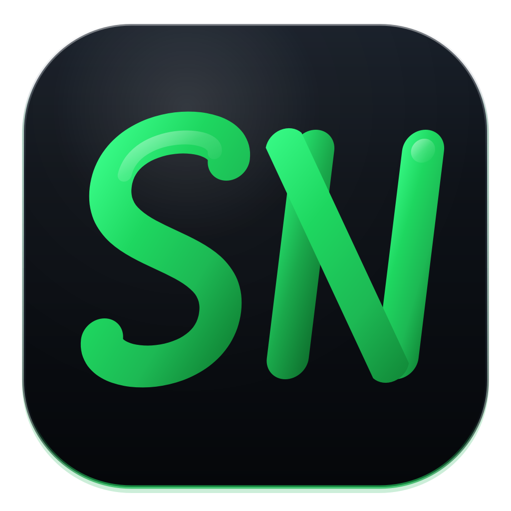
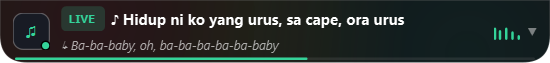
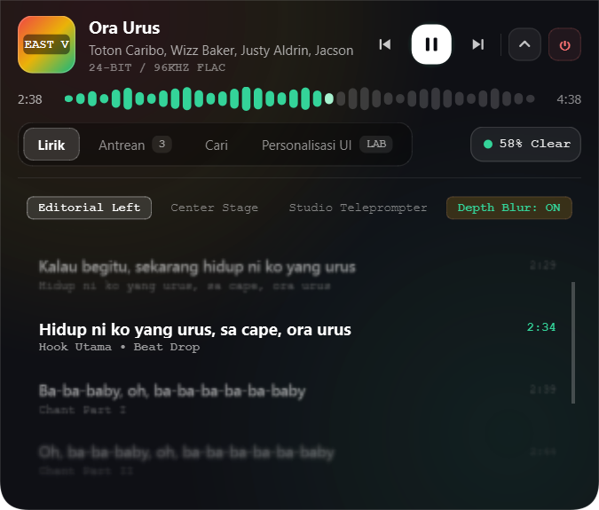
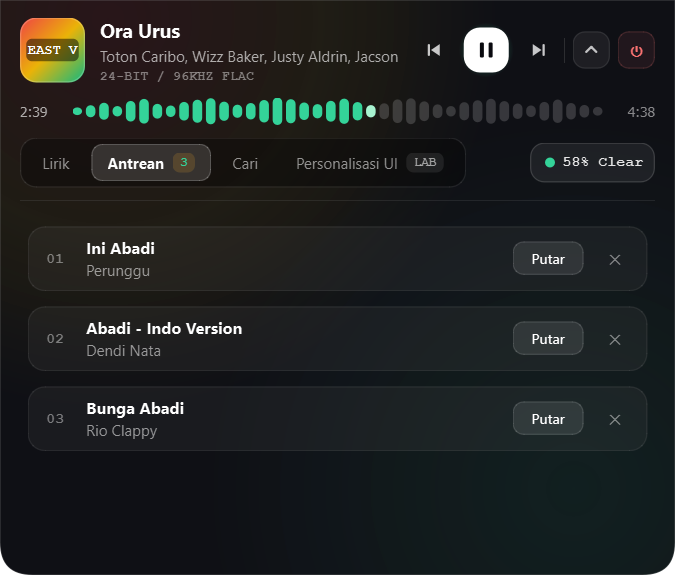
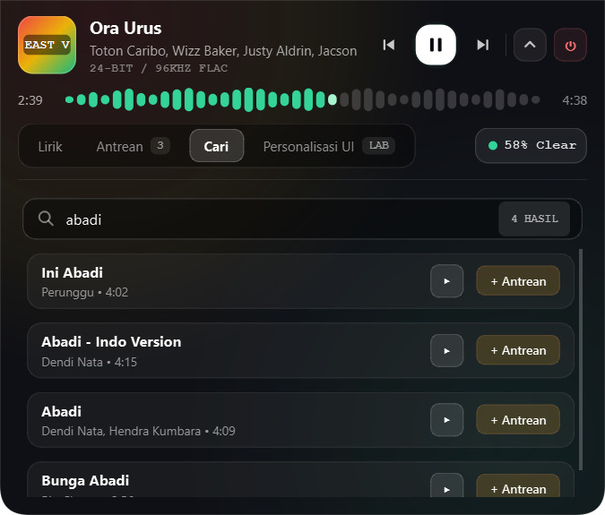
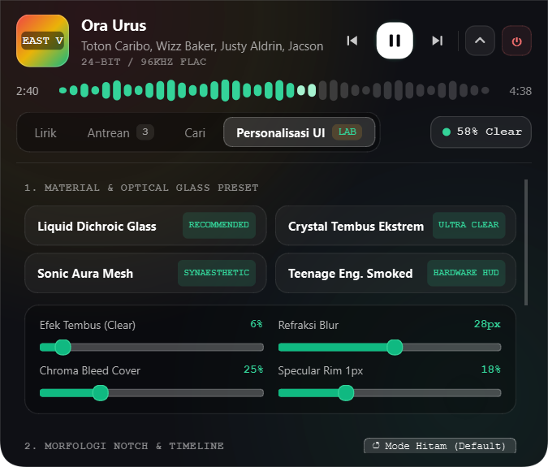
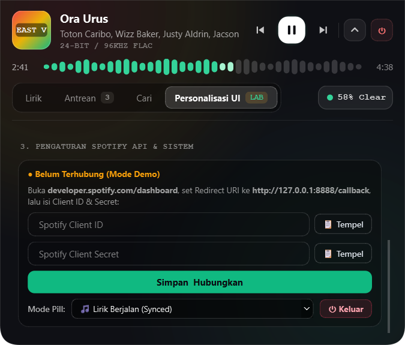

<div align="center">



# spfnotch

**Notch melayang ala Dynamic Island untuk Spotify di Windows.**
Lagu yang diputar, lirik tersinkron, antrean, dan pencarian - tepat di bawah webcam.

[](LICENSE)


[English](README.md) · **Bahasa Indonesia**



</div>

> [!NOTE]
> spfnotch adalah proyek **tidak resmi** dan tidak berafiliasi atau didukung oleh
> Spotify AB. Hanya memakai Web API resmi Spotify. Lihat [LEGAL.md](LEGAL.md).

---

## ✨ Fitur

- 🏝️ **Notch Dynamic Island** - pil hitam *frameless*, selalu di atas, menempel di tengah atas layar.
- 🎞️ **Animasi morphing** - mengembang saat di-hover/klik, mengecil otomatis saat mouse pergi.
- ⏯️ **Kontrol playback** - previous, play/pause, next, dan **waveform scrubber** untuk seek.
- 🎤 **Lirik tersinkron** (LRCLIB) - bergulir otomatis, baris aktif disorot, klik baris untuk lompat. 3 gaya: *Editorial Left*, *Center Stage*, *Studio Teleprompter* + depth blur.
- 📜 **Antrean** - lihat lagu berikutnya dan langsung putar.
- 🔍 **Pencarian** - cari lagu, putar langsung atau tambahkan ke antrean.
- 🎨 **Personalisasi** - preset kaca, slider clear/blur/chroma/specular, morfologi notch, warna aksen dari cover album.
- 💤 **Mode pil idle** - tampilkan lirik berjalan atau info lagu saat ringkas.
- 🪶 **Ringan** - RAM ~45-55 MB, CPU ~0.1-0.3%.
- 🙅 **Tidak mencuri fokus** - tombol kontrol tidak mengganggu ketikan di aplikasi lain.
- 🧪 **Mode Demo** - coba seluruh UI sebelum menghubungkan akun.
- 🔒 **Privat** - kredensial & token hanya tersimpan di PC kamu. Tanpa telemetri.

## 📸 Screenshot

| Lirik tersinkron | Antrean |
|---|---|
|  |  |
| **Cari** | **Personalisasi UI** |
|  |  |
| **Koneksi Spotify** | **Pil ringkas** |
|  |  |

## 📋 Kebutuhan

- Windows 10 / 11
- Spotify Desktop (atau perangkat Spotify Connect lain) sudah login
- Akun **Spotify Premium** untuk kontrol playback / antrean (aturan Spotify; akun Free tetap bisa melihat info lagu)
- Aplikasi Spotify Developer gratis (setup 5 menit)
- Python 3.10+ *(hanya jika menjalankan dari source)*

## 🚀 Instalasi

### Opsi A - Download .exe (disarankan)

1. Buka [**Releases**](https://github.com/tjhhh/SpfNotch/releases/latest), download `spfnotch.exe`.
2. Taruh di folder sendiri (mis. `C:\Apps\spfnotch\`) - `config.json` akan dibuat di sebelahnya.
3. Klik dua kali `spfnotch.exe`.

> [!TIP]
> Jika muncul peringatan SmartScreen (exe belum ditandatangani), klik **More info → Run anyway**, atau build sendiri dari source.

**Jalan otomatis saat startup:** `Win + R` → `shell:startup` → taruh shortcut `spfnotch.exe` di folder itu.

### Opsi B - Dari source

```powershell
git clone https://github.com/tjhhh/SpfNotch.git
cd SpfNotch
python -m venv .venv
.venv\Scripts\activate
pip install -r requirements.txt
python app/main.py
```

Atau klik dua kali `start_notch.bat`.

## 🔗 Cara Menghubungkan ke Spotify (sekali saja)

spfnotch memakai model **kredensial milik sendiri**: kamu membuat aplikasi Spotify Developer sendiri (gratis), sehingga data hanya mengalir antara PC kamu dan Spotify.

1. Buka [Spotify Developer Dashboard](https://developer.spotify.com/dashboard), login dengan akun Spotify.
2. Klik **Create app**, isi:

   | Kolom | Isi |
   |---|---|
   | App name | `spfnotch` (bebas) |
   | App description | `Personal desktop notch widget` |
   | Redirect URI | **`http://127.0.0.1:8888/callback`** - harus persis, lalu klik **Add** |
   | Which API/SDKs? | ✅ **Web API** |

   Centang persetujuan → **Save**.
3. Buka app → **Settings**, salin **Client ID** dan **Client Secret** (*View client secret*).
4. *(Jika dipakai orang lain selain pemilik app)* buka **User Management**, tambahkan nama + email Spotify mereka (maks. 5 user di Development Mode).
5. Di spfnotch: hover notch → tab **Personalisasi UI** → scroll ke **3. Pengaturan Spotify API & Sistem** → tempel Client ID & Secret → **Simpan & Hubungkan**.
6. Browser terbuka ke halaman otorisasi Spotify → klik **Agree** → muncul *"Otorisasi Berhasil"* → tutup tab. Selesai! 🎉

Token disimpan lokal di `.spotify_token_cache` dan diperbarui otomatis.

**Izin yang diminta:** `user-read-playback-state`, `user-modify-playback-state`, `user-read-currently-playing`. Tidak ada akses ke playlist, library, email, atau followers.

**Memutus koneksi:** hapus `config.json` & `.spotify_token_cache`, dan/atau cabut akses di <https://www.spotify.com/account/apps/>.

## 🛠️ Troubleshooting

| Masalah | Solusi |
|---|---|
| `INVALID_CLIENT: Invalid redirect URI` | Redirect URI di dashboard harus persis `http://127.0.0.1:8888/callback` (bukan `localhost`). |
| Tetap "Mode Demo" | Kredensial salah / otorisasi timeout (60 dtk). Tempel ulang lalu **Simpan & Hubungkan**. |
| `403` / user not registered | Tambahkan email Spotify di **User Management**. Pemilik app wajib Premium. |
| Tombol kontrol tidak berfungsi | Butuh Premium dan perangkat **aktif** - putar lagu dulu di Spotify. |
| Lirik tidak muncul | LRCLIB belum punya lirik tersinkron untuk lagu tersebut. |

## 🚧 Batasan

### Yang tidak akan pernah dilakukan spfnotch (sengaja dirancang begitu)

- ❌ Mengunduh, merekam, menyimpan, atau mengonversi audio
- ❌ Memblokir iklan atau membuka fitur Premium
- ❌ Memodifikasi / menyuntik / mem-patch aplikasi Spotify
- ❌ Menyertakan atau membagikan Client ID / Secret Spotify
- ❌ Mengirim data ke mana pun selain Spotify dan LRCLIB (tanpa telemetri, tanpa server sendiri)
- ❌ Dijual atau dipakai komersial bersama konten Spotify

### Keterbatasan yang diketahui

| Area | Batasan |
|---|---|
| **Platform** | Hanya Windows 10/11 (memakai Win32 API). Belum ada versi macOS/Linux. |
| **Akun Spotify** | Play/pause/skip/seek/antrean/putar dari pencarian butuh **Premium**. Akun Free hanya bisa melihat info lagu. |
| **Developer app** | Development Mode: pemilik app wajib **Premium**, maks. **5 user** per Client ID. Extended quota butuh badan usaha dengan 250rb+ MAU - karena itu spfnotch memakai kredensial milik masing-masing user. |
| **Perangkat aktif** | Kontrol hanya jalan jika ada perangkat Spotify yang aktif. |
| **Latensi** | Status di-poll tiap ~2 detik; perubahan dari aplikasi lain bisa telat hingga 2 detik. |
| **Lirik** | Tergantung ketersediaan di LRCLIB; sebagian lagu tidak punya lirik tersinkron. |
| **Izin (scope)** | Hanya scope playback - tidak bisa kelola playlist, library, likes, atau info akun. |
| **Port OAuth** | Login memakai callback lokal tetap `127.0.0.1:8888` (timeout 60 dtk). |
| **Layar** | Menempel di tengah atas layar (layar utama). Belum bisa digeser. |
| **Lokasi instalasi** | `config.json` ditulis di sebelah exe, jadi folder harus bisa ditulis (hindari `C:\Program Files`). |
| **Bahasa UI** | UI aplikasi saat ini hanya Bahasa Indonesia. |
| **Binary** | `.exe` belum ditandatangani (code-signed), SmartScreen bisa memberi peringatan. |
| **Ketentuan** | Spotify bisa mengubah API / Developer Terms kapan saja, yang bisa membatasi fitur. |

## ⚖️ Apakah ini legal?

**Ya, untuk penggunaan pribadi.** spfnotch hanyalah *remote control* yang memakai **Web API resmi Spotify** dengan login OAuth standar. Tidak mengunduh/merekam/rip audio, tidak memblokir iklan, tidak membuka fitur Premium, dan tidak memodifikasi aplikasi Spotify. Aplikasi ini **tidak** menyertakan kredensial Spotify apa pun - setiap pengguna mendaftarkan app developer sendiri sesuai aturan Spotify. Detail lengkap, area abu-abu (lirik), dan privasi: **[LEGAL.md](LEGAL.md)**.

## 📄 Lisensi

Kode sumber: [MIT](LICENSE) © 2026 tjhhh. Komponen pihak ketiga (PyQt6 - GPL v3, Montserrat - OFL 1.1): [THIRD_PARTY_NOTICES.md](THIRD_PARTY_NOTICES.md).

<sub>Spotify adalah merek dagang Spotify AB. Proyek ini tidak berafiliasi dengan Spotify.</sub>
